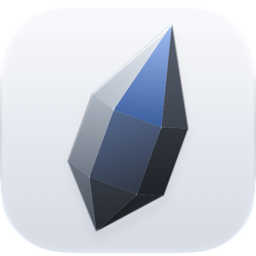
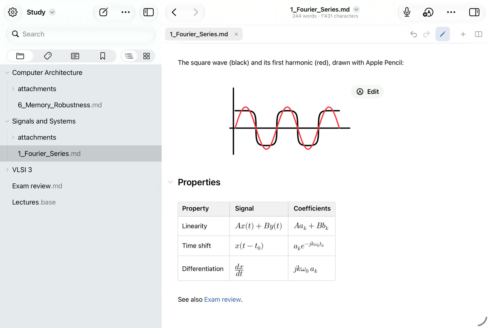
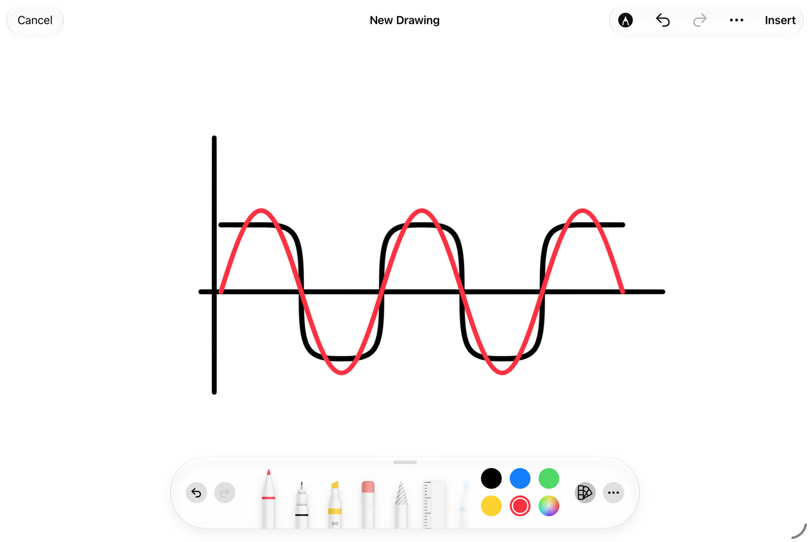
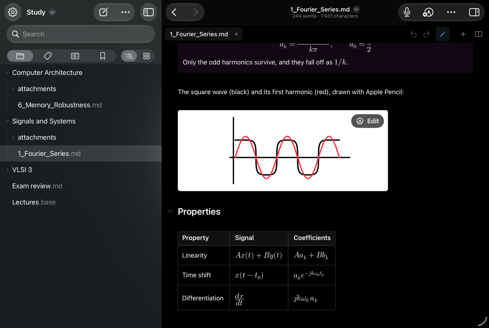
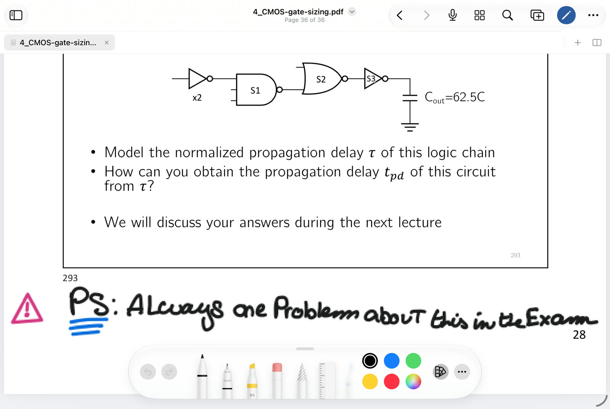
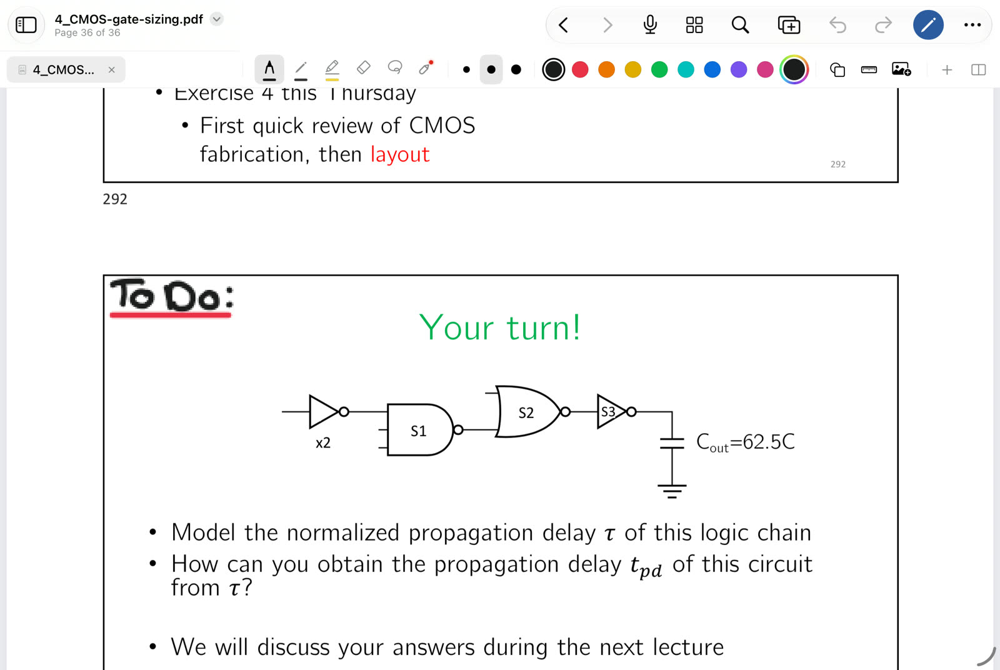
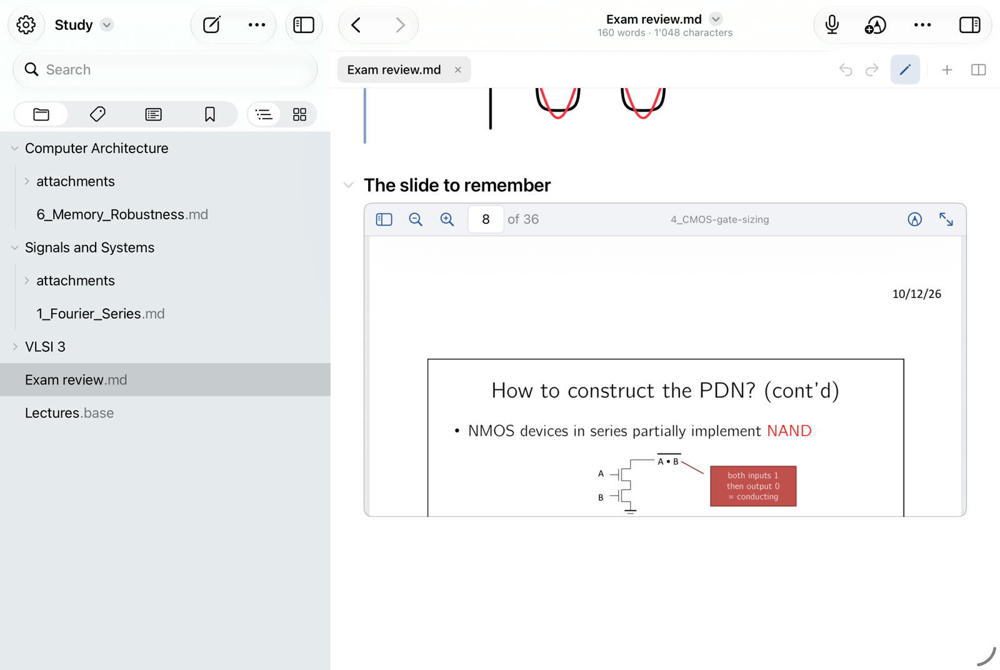
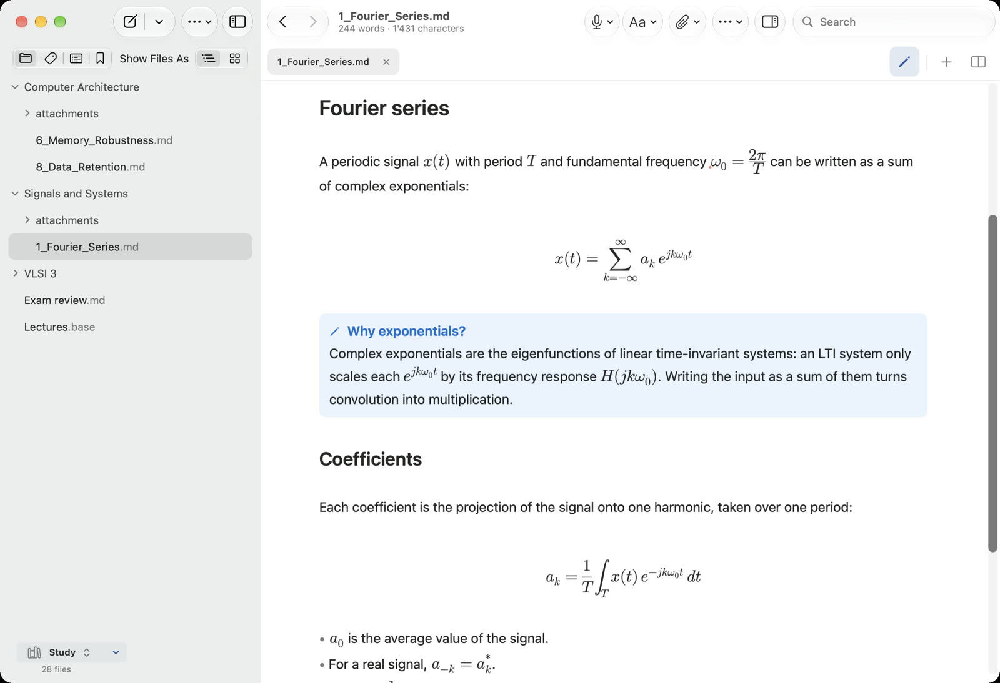

<p align="center">
  
</p>

<h1 align="center">Graphite</h1>

<p align="center">
  <strong>An Apple Pencil-first study app for your Obsidian vault.</strong><br>
  Notes, handwriting, PDFs and lecture recordings, kept as ordinary files you own.
</p>

<p align="center">
  
  
  
  <a href="LICENSE"></a>
</p>

<p align="center">
  <picture>
    <source media="(prefers-color-scheme: dark)" srcset="AddOns/WelcomeTour/WelcomeTourDrawingInNote-dark.jpg">
    
  </picture>
</p>

Graphite gives an Obsidian vault the notebook and PDF tools of Goodnotes without locking anything away. It opens an ordinary folder and edits it in place: notes stay Markdown, notebooks and slides stay PDF, drawings stay PNG, PDF or SVG, and recordings stay M4A. If Graphite disappeared tomorrow, Obsidian, Finder, Preview and any Markdown editor could still read every file.

It is a native app written in Swift, built iPad-first for lectures and handwriting, with a Mac app that stays small and fast and an iPhone app that works as a quick Obsidian client.

## Features

- **Markdown, the Obsidian way.** Live Preview, reading view and source mode; Wikilinks, embeds, callouts, math, tables, tasks, tags, properties and frontmatter, without rewriting notes on open.
- **Pencil drawings inside notes.** Draw on a full-width canvas and Graphite saves an ordinary image in your attachment folder with a normal `![[embed]]`, re-editable later.
- **PDF notebooks.** One system for blank notebooks, lecture slides, worksheets and scans: paper templates, page thumbnails, reordering, bookmarks, and annotations stored in the PDF itself.
- **Lecture recording** that keeps going while you move between documents.
- **Knowledge tools.** Full-text search, backlinks, outgoing and unresolved links, outline, tags, Bases (table, cards, list and map views), each switchable like Obsidian's core plugins.
- **Obsidian community plugins and themes**, run from the vault's own `.obsidian` folder. See [what works today](Docs/Community-plugins.md).
- **Import from Goodnotes and Notability** into ordinary PDFs and recordings.
- **A small core.** Extras such as voices and tour pictures are downloaded on first use, so the app stays light in size, memory and battery.

## Apple Pencil drawings inside notes

Put the cursor where a derivation, a circuit or a sketch belongs and insert a drawing. Graphite opens a canvas as wide as the note that grows downward as you write, with PencilKit's tools. **Insert** saves it next to your other attachments and places a normal embed, such as `![[Fourier harmonics.png]]`, where the cursor was.

You choose the file format. PNG keeps every brush exactly as drawn, and PDF or SVG keeps the ink as sharp vector lines. Each format can be opened in Graphite and edited stroke by stroke again, while Obsidian, Preview or a browser simply sees an image.

<table>
  <tr>
    <td width="50%"></td>
    <td width="50%"></td>
  </tr>
  <tr>
    <td align="center"><sub>Drawing on the canvas</sub></td>
    <td align="center"><sub>The drawing inside the note, with an Edit button to change it later</sub></td>
  </tr>
</table>

## Annotating PDFs

Lecture slides, papers and notebooks are PDFs, and Graphite writes on them directly. Choose a pen, highlighter or eraser from a palette that floats over the page, or keep the tools in a bar above it. Ink is saved as standard PDF annotations, so Preview, Acrobat and Obsidian show what you wrote. Pages can be added, reordered, rotated and bookmarked, and blank notebooks get real paper (dotted, grid, ruled, Cornell and more) as page content.

A PDF page also embeds in a note at the height you choose, so the slide you need sits next to your notes on it.

<table>
  <tr>
    <td width="50%"></td>
    <td width="50%"></td>
  </tr>
  <tr>
    <td align="center"><sub>Writing on slides with the floating palette</sub></td>
    <td align="center"><sub>Or with the tools in a fixed bar</sub></td>
  </tr>
  <tr>
    <td colspan="2"></td>
  </tr>
  <tr>
    <td colspan="2" align="center"><sub>A slide embedded in a note</sub></td>
  </tr>
</table>

## A Mac app that stays light

On the Mac, Graphite is a Mac app through and through: SwiftUI and AppKit, real menus, windows and keyboard shortcuts. No browser engine draws your notes. A web view starts only if you turn on community plugins. A vault opens without waiting for a full scan, search reads an index kept on disk, and the whole vault is never loaded into memory.

<p align="center">
  
</p>

| Measured on the Mac | Result |
| --- | --- |
| App size | 60 MB |
| Launch to first window | 0.7 to 1.0 s |
| Memory at rest, vault and note open | 137 MB (58 MB with no vault) |
| Processor time at rest | 0.00 to 0.01 s over 30 s |
| Typing in a list item, median frame | 7.6 ms |
| Search in a vault of 100,000 notes, slowest queries | 11 to 28 ms per keystroke |
| A vault of 36,392 files | Opens, and the main thread is idle 7 s after launch |

<sub>Release builds on the developer's Mac, with a 28-file vault unless the row names another. The 36,392-file vault was opened in a debug build. Each figure, how it was taken and what was not measured are in [Implementation coverage](Docs/Coverage.md).</sub>

## Status

Graphite is in beta on TestFlight as **Graphite Note**, for iPad, iPhone and Mac. It is under active development: what has been built and how it was checked is recorded in [Implementation coverage](Docs/Coverage.md), and incomplete work is listed there too.

## Building

Requirements: Xcode 27 and the iOS 27 and macOS 27 SDKs.

1. Open `Graphite.xcodeproj` and run the **Graphite** scheme on an iPad, an iPhone, a simulator or My Mac. Set your own development team under Signing & Capabilities.
2. Run the package tests from the command line:

```bash
swift test --parallel
```

The checks continuous integration runs are described at the top of [`.github/workflows/ci.yml`](.github/workflows/ci.yml).

## Contributing

Contributions are welcome. Read [CONTRIBUTING.md](CONTRIBUTING.md) first: [OBJECTIVE.md](OBJECTIVE.md) defines what Graphite is and the file formats it must keep, and [RULES.md](RULES.md) with [Docs/solid/](Docs/solid/README.md) define how code is written. To report a vulnerability, see [SECURITY.md](SECURITY.md).

## Engineering standard

The goal is the fastest and most resource-efficient app Graphite can be: robust, free of defects, fast, fluid and reliable. [Docs/solid/](Docs/solid/README.md) is the binding standard for that goal: an audit of every line at commit `b13dec3` (2026-10-18) with its findings, the 76 verified defects, the 413 invariants a change must keep, and the rules all new code is held to (`FR-01` onward, with a review checklist), plus the phased plan that brings the existing code there. [RULES.md](RULES.md) and [OBJECTIVE.md](OBJECTIVE.md) stay authoritative over it.

The audit found the Core value types, file formats and storage contracts sound, and the coordinating layer weak: one workspace object holds 86 stored properties, there is no composition root, and several rules are implemented more than once and already disagree. [Docs/solid/rule-status.md](Docs/solid/rule-status.md) states which rules the code meets today, [Docs/solid/status.md](Docs/solid/status.md) the state of every finding, and [Docs/solid/progress.md](Docs/solid/progress.md) what each cleanup wave changed. `python3 scripts/size-report.py` checks function, type and file sizes against the review register.

## Evidence and implementation status

The 2026-10-18 audit read source and tests at `b13dec3` without running builds, tests, the simulator or a device; its limits are listed in [Docs/solid/README.md](Docs/solid/README.md#limits). It makes no numerical compliance claim.

- [Architecture](Docs/Architecture.md): module direction, ownership, storage, and technical risks.
- [Implementation coverage](Docs/Coverage.md): implemented behavior, dated validation, and incomplete or unverified work.
- [SOLID and clean-code standard](Docs/solid/README.md): findings, defects, invariants, rules for new code, and the cleanup plan.
- [Community plugins](Docs/Community-plugins.md): how Graphite runs Obsidian community plugins, what works, what does not yet, and how it was checked.
- [Releasing to TestFlight](Docs/TestFlight.md): the App Store Connect record, uploading a build, and what the upload declares.

After each cleanup wave, update [Docs/solid/progress.md](Docs/solid/progress.md), [status.md](Docs/solid/status.md) and [rule-status.md](Docs/solid/rule-status.md) from the current code. Feature completeness and test counts alone do not establish SOLID compliance.

## License

Graphite is licensed under the [Apache License 2.0](LICENSE). Code under `Vendor/` keeps its own license, stated in each folder. See [NOTICE](NOTICE).
